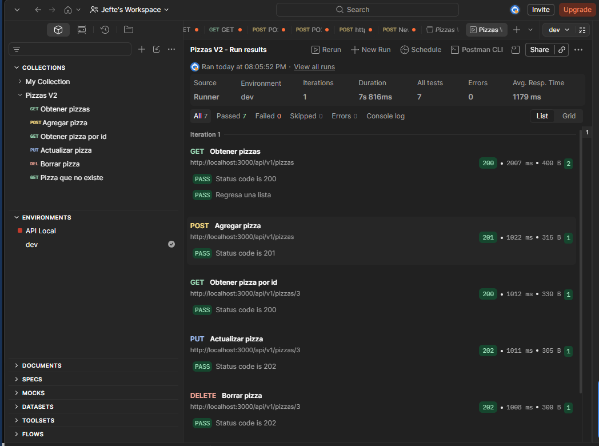
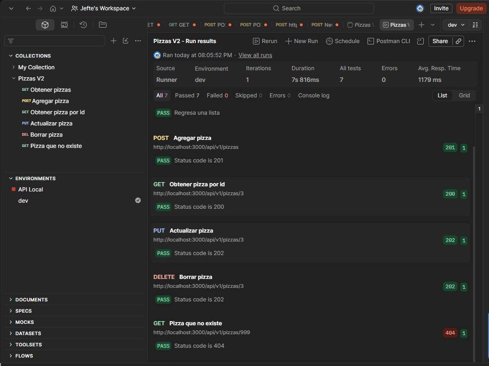

# Pizzas V2

CRUD de pizzas hecho con Node.js y Express. Las pizzas se guardan en memoria dentro de `repositorios/pizza.repositorio.js`, así que al reiniciar el servidor se regresan a las dos pizzas iniciales.

Alumno: Uriel Jefté Aguirre Rivera

## Estructura

```
PizzasV2
├── index.js                      # rutas del API (controlador)
├── repositorios
│   └── pizza.repositorio.js      # capa de datos: obtener, agregar, actualizar y borrar
├── postman
│   ├── PizzasV2.postman_collection.json
│   └── dev.postman_environment.json
├── .http                         # pruebas rápidas con REST Client de VS Code
└── package.json
```

## Cómo ejecutarlo

1. Instalar las dependencias:

   ```
   npm install
   ```

2. Levantar el servidor:

   ```
   npm run dev
   ```

   (o `npm start` si no se quiere usar nodemon)

3. El API queda en `http://localhost:3000`.

## Endpoints

| Método | Ruta | Qué hace | Respuesta |
|---|---|---|---|
| GET | `/api/v1/pizzas` | Lista todas las pizzas | 200 |
| GET | `/api/v1/pizzas/:id` | Regresa una pizza | 200, o 404 si no existe |
| POST | `/api/v1/pizzas` | Agrega una pizza | 201 con `{ id, fecha }`, o 400 si falta el nombre |
| PUT | `/api/v1/pizzas/:id` | Actualiza nombre y descripción | 202, o 404 si no existe |
| DELETE | `/api/v1/pizzas/:id` | Borra una pizza | 202, o 404 si no existe |

Ejemplo de body para POST y PUT:

```json
{
  "nombre": "Pepperoni",
  "descripcion": "Pepperoni y queso"
}
```

## Pruebas

- **Postman:** importar los dos archivos de la carpeta `postman`, elegir el ambiente `dev` y correr la colección. Los request van en orden: agrega una pizza, la consulta, la actualiza y la borra.
- **VS Code:** con la extensión REST Client abrir el archivo `.http` y darle "Send Request" a cada petición.

## Resultado de las pruebas en Postman

Se corrió la colección completa con el ambiente `dev`: 7 pruebas pasadas, 0 fallidas.




